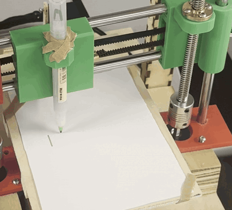
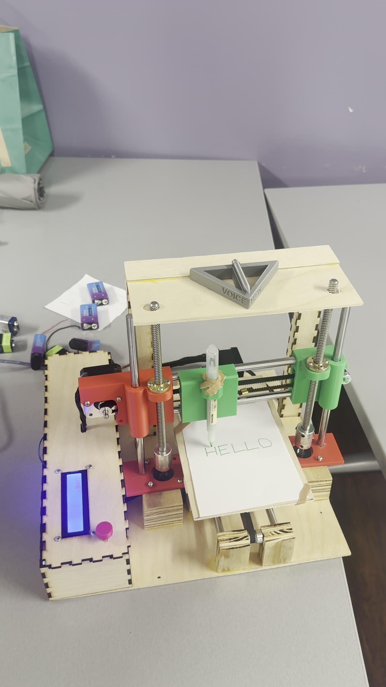
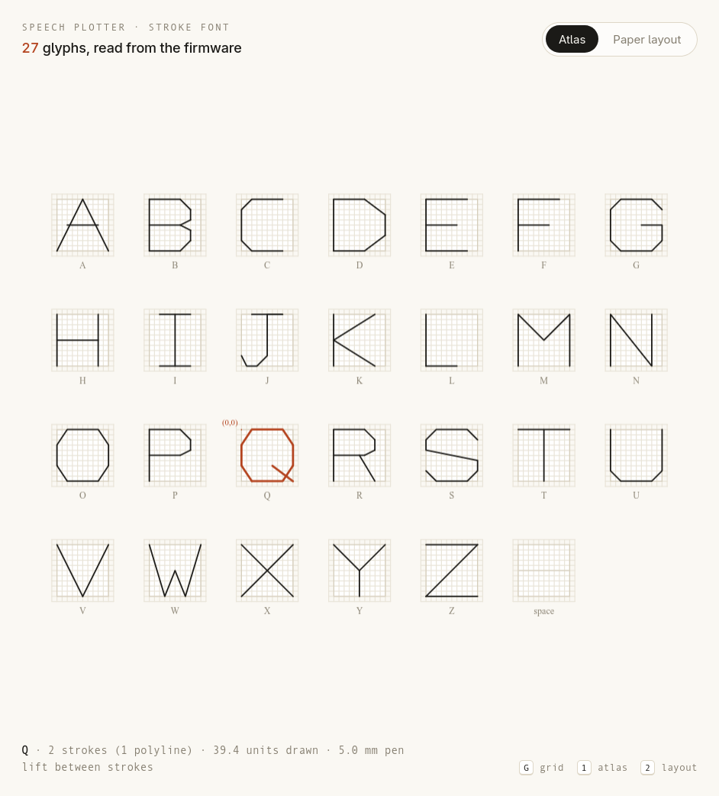
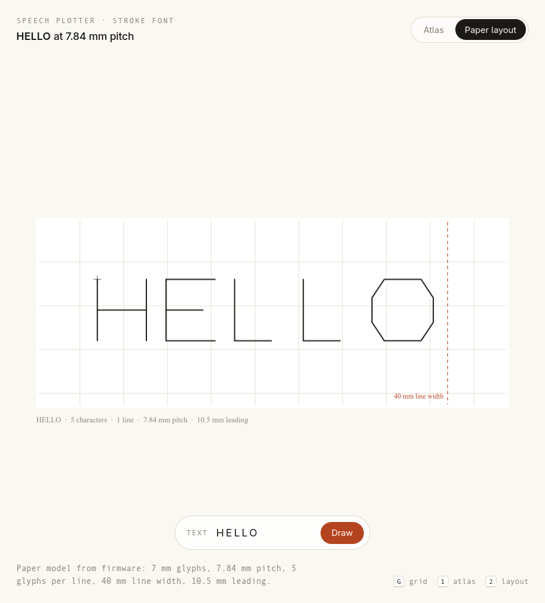
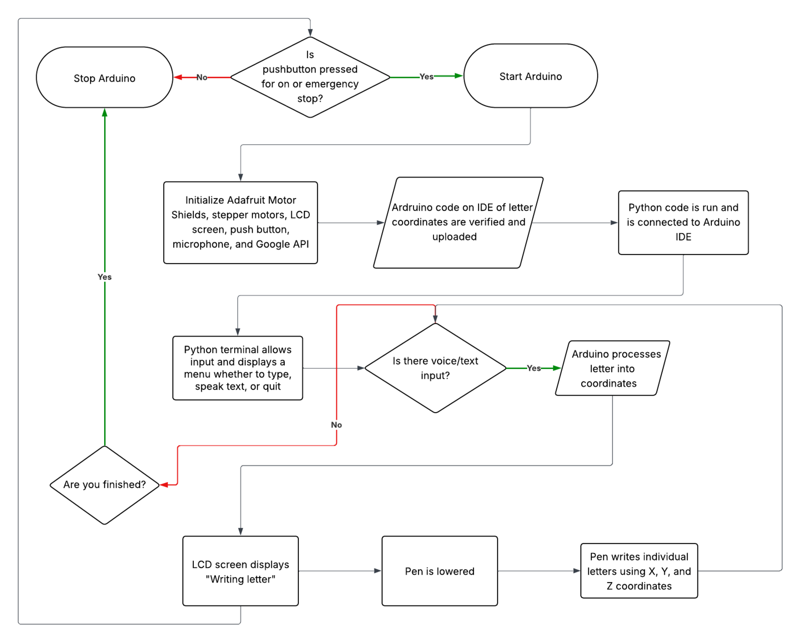

# Voice Plotter

A pen plotter that writes what you say. You speak, it prints on paper.

I built the software for this four-person engineering project. The machine is a
desk-sized 3-axis plotter, modeled on the motion system of an open-frame 3D
printer, that turns a spoken word into handwriting at about 15 seconds per
letter. It was built for EG-UY 1004 SLDP at NYU Tandon, Fall 2025, where the
team shipped it as AudioPrinter.


## What it does

- Python records a phrase, transcribes it with Google Speech-to-Text, uppercases
  it, and sends it over serial at 9600 baud.
- The Arduino looks each character up in a hand-authored stroke font, converts
  strokes into stepper coordinates, and drives four stepper motors through two
  I2C motor shields.
- X moves the pen carriage on a timing belt, Y moves the paper platform, and two
  lead screws lift the pen.

```
microphone -> 16 kHz capture -> Speech-to-Text -> ASCII over serial
           -> stroke font -> 0.7 scale -> 10 steps/mm -> 4 steppers
```

## Demo



[`printing-hello-3x.mp4`](media/demo/printing-hello-3x.mp4) runs the whole print
at 3x with no audio. The unedited recording, real time with audio, is
[`printing-hello.mp4`](media/demo/printing-hello.mp4).



## Glyph atlas





`tools/extract_glyphs.py` reads `drawLetterA()` through `drawLetterZ()` and
writes `web/glyphs.js`, so the atlas is drawn from the same numbers the machine
uses. `web/` is interactive: click a glyph to watch the pen draw it, or switch
to the paper layout and type your own text. Add `?clean=1` to render the
diagrams without the interface.

```bash
python3 -m http.server 8000
# http://localhost:8000/web/
```

The sketch also runs on the p5 editor: [editor.p5js.org/aandrx/full/zdDhS4Kv7](https://editor.p5js.org/aandrx/full/zdDhS4Kv7).

## System design

| Piece | Choice |
| --- | --- |
| Motion | 4 steppers, 2 Adafruit Motor Shields at I2C 0x60/0x61, 10 steps/mm |
| Axes | X belt on the gantry, Y belt under the paper platform, Z on two lead screws |
| Font | 27 glyphs as line and polyline strokes on a 0-10 unit grid, y down |
| Layout | 7.0 mm glyphs, 7.84 mm pitch, 40 mm line limit, 10.5 mm leading |
| Protocol | Newline-terminated ASCII: text to render, jog commands, `STOP` |
| Feedback | None. Open loop, no endstops, no encoders |

Speech and motion were built as separate systems and joined at the serial port.
Everything above it is Python and a cloud API. Everything below is firmware that
knows only text and coordinates.



Deeper notes: [architecture](docs/architecture.md) (wiring, axis signs, protocol
table, motion math), [design decisions](docs/design-decisions.md) (what was
tried, rejected, and why), [the font](docs/font.md) (grid, metrics, adding a
glyph), [case study](docs/case-study.md) (long-form write-up).

## Repo map

| Path | What it is |
| --- | --- |
| `firmware/voice_plotter/voice_plotter.ino` | The Arduino sketch: font, motion, protocol, LCD |
| `host/plotter_host.py` | Speech capture, transcription, serial sender, operator menu |
| `web/` | p5 glyph atlas and paper-layout preview |
| `tools/extract_glyphs.py` | Parses the firmware into `web/glyphs.js` + `.json` |
| `media/` | Photos, demo clip, code flowchart, circuit diagram |
| `docs/` | Architecture, decisions, font, case study |

## Numbers

| Quantity | Value | Source |
| --- | --- | --- |
| Glyphs | 27 (A-Z and space), 73 drawing ops | `tools/extract_glyphs.py` |
| Glyph box | 7.0 mm (10 units at 0.7 scale) | `SCALE 0.7` |
| Letter pitch | 7.84 mm | width + 1.2 steps of spacing |
| Usable line | 40 mm, 5 glyphs, then wrap | `FULL_WIDTH_STEPS 400` |
| Pen lift | 5 mm | `PEN_UP_STEPS 50`, `PEN_DOWN_STEPS 0` |
| Print speed | about 15 s per letter | submission video, 5 letters in 89 s |
| Build cost | $226.73 | final presentation |

## Running it

The atlas needs only a static server, above. Regenerate the glyph data with
`python3 tools/extract_glyphs.py`.

**Firmware.** Open `firmware/voice_plotter/voice_plotter.ino` in the Arduino
IDE. Board: Arduino UNO. Libraries: Adafruit Motor Shield V2, AccelStepper,
LiquidCrystal_I2C. The shields must be jumpered to 0x60 and 0x61. If motor
initialization fails the sketch prints the missing address and blinks the status
LED instead of moving.

**Host.**

```bash
cd host
python3 -m venv .venv && source .venv/bin/activate
pip install -r requirements.txt
export GOOGLE_APPLICATION_CREDENTIALS=/path/to/service-account.json
export PLOTTER_PORT=COM5          # or /dev/ttyUSB0
python3 plotter_host.py
```

The menu offers speech capture, manual text entry for bench testing, a motor
test submenu (`UP`, `DOWN`, `LEFT`, `RIGHT`, `FORWARD`, `BACK`, `HOME`), and a
confirmed emergency stop.

## Limits

- **Open loop.** No endstops, no encoders, no paper or pen-contact sensing.
  Position is assumed, so the machine must start from a known physical position.
- **Blocking motion.** `moveToXY` and `moveZ` spin until they reach their target,
  so a stop means sending `STOP`, which releases the motors and halts.
- **Uppercase only.** 26 letters and a space. No digits, punctuation, lowercase.
- **One line, one size.** 40 mm wide, 7 mm letters, fixed width.
- **Not standalone.** The voice path needs a laptop, Python, and a cloud API.

Next steps are listed in
[`docs/design-decisions.md`](docs/design-decisions.md#what-i-would-do-next):
endstops and homing, a non-blocking motion state machine, runtime glyph data, a
look-ahead planner, then on-device speech recognition.

## Author

Andrew Liu. Software: firmware, stroke font, serial protocol, speech front end,
code flowcharts, integration testing.

The machine was a four-person course project; this repo holds the software and
the material needed to understand and demonstrate it. CAD, 3MF, and STL sources
are not included.

## License

MIT, see [LICENSE](LICENSE).
