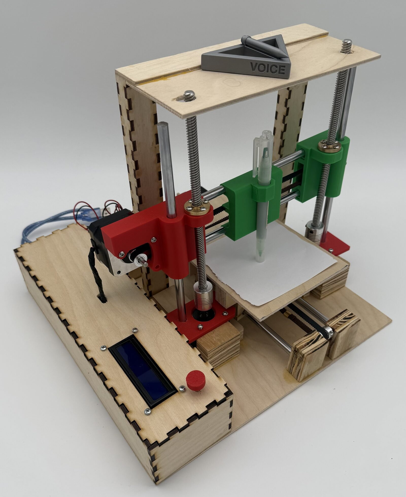

# AudioPrinter

A voice-driven pen plotter. You speak, it writes on paper.

This is the software and system design for a four-person engineering project: a
desk-sized 3-axis machine, modelled on the motion system of an open-frame 3D
printer, that turns a spoken word into handwriting in about 15 seconds per
letter. I was the coding lead.



## What it does

- Python records a phrase, sends it to Google Speech-to-Text, uppercases the
  transcript, and pushes it over serial at 9600 baud.
- The Arduino looks each character up in a hand-authored stroke font, converts
  the strokes into stepper coordinates, and drives four stepper motors through
  two Adafruit Motor Shields.
- X moves the pen carriage on a timing belt, Y moves the paper platform, and two
  lead screws lift the pen.

A 27-glyph stroke font, a serial command protocol, the speech front end, the
code flowcharts, and the integration testing were my part. Mechanical design,
circuitry, and project management were other people's. See
[Credits](#credits).

## Demo

[`media/demo/printing-hello.mp4`](media/demo/printing-hello.mp4) is the
unmodified submission recording: voice input, then "HELLO" printed under its own
power. The still below is the final frame.


## The font atlas

[`web/`](web/) is an interactive atlas of every glyph, generated from the
firmware rather than transcribed.

- **Atlas**: all 27 glyphs on their 0-10 unit grid. Hover for stroke counts and
  draw length, click to watch the pen lift, travel, and draw in the firmware's
  own order.
- **Paper layout**: type any text and see it laid out exactly as the machine
  would place it, in millimetres, with the 40 mm line limit and 5 glyphs per
  line. Then watch it print.

```bash
python3 -m http.server 8000
# open http://localhost:8000/web/
```

`web/glyphs.js` is generated by `tools/extract_glyphs.py`, which parses
`drawLetterA()` through `drawLetterZ()` in the firmware and resolves the
`getLetterX` / `getLetterY` calls back into coordinates. Change a glyph in the
firmware, rerun the script, and the atlas follows.

## Repo map

| Path | What it is |
| --- | --- |
| `firmware/audioprinter/audioprinter.ino` | The final Arduino sketch: font, motion, serial protocol, LCD |
| `host/plotter_host.py` | Speech capture, transcription, serial sender, operator menu |
| `web/` | p5.js glyph atlas and paper-layout preview |
| `tools/extract_glyphs.py` | Parses the firmware into `web/glyphs.js` + `.json` |
| `media/` | Photos, demo clip, code flowchart, circuit diagram |
| `docs/architecture.md` | Wiring, axis conventions, protocol, motion maths |
| `docs/design-decisions.md` | What was tried, rejected, and why |
| `docs/font.md` | The glyph grid, metrics, and how to add a letter |
| `docs/timeline.md` | Week-by-week build log |
| `docs/case-study.md` | Long-form write-up for a portfolio page |

## Numbers that matter

| Quantity | Value | Source |
| --- | --- | --- |
| Glyphs | 27 (A-Z and space), 73 drawing ops | `tools/extract_glyphs.py` |
| Glyph box | 7.0 mm (10 units at 0.7 scale) | `SCALE 0.7`, `LETTER_WIDTH_STEPS` |
| Letter pitch | 7.84 mm | width + 1.2 steps of spacing |
| Usable line | 40 mm, 5 glyphs, then wrap | `FULL_WIDTH_STEPS 400` |
| Line leading | 10.5 mm | `LINE_SPACING_STEPS 150` |
| Pen lift | 5 mm | `PEN_UP_STEPS 50`, `PEN_DOWN_STEPS 0` |
| Resolution | 10 steps per mm | `STEPS_PER_MM` |
| Print speed | about 15 s per letter | submission video, 5 letters in 89 s |
| Build cost | $226.73 | final presentation, Table 1 |

## Running it

**Atlas** needs nothing but a static server, above.

**Regenerating glyph data**:

```bash
python3 tools/extract_glyphs.py
```

**Firmware**: open `firmware/audioprinter/audioprinter.ino` in the Arduino IDE.
Board: Arduino UNO. Libraries: Adafruit Motor Shield V2, AccelStepper,
LiquidCrystal_I2C. The two shields must be jumpered to addresses 0x60 and 0x61.
If motor initialisation fails the sketch prints the failing address and blinks
the status LED instead of moving.

**Host**:

```bash
cd host
python3 -m venv .venv && source .venv/bin/activate
pip install -r requirements.txt
export GOOGLE_APPLICATION_CREDENTIALS=/path/to/service-account.json
export PLOTTER_PORT=COM5          # or /dev/ttyUSB0
python3 plotter_host.py
```

The host menu offers speech capture, manual text entry for bench testing, a
motor-test submenu (`UP`, `DOWN`, `LEFT`, `RIGHT`, `FORWARD`, `BACK`, `HOME`),
and a confirmed emergency stop.

## Limitations

These are real, and they shape what the machine can do.

- **Open loop.** No endstops, no encoders, no paper or pen-contact sensing.
  Position is assumed, not measured, so the machine must be started from a known
  physical position.
- **Blocking motion.** `moveToXY` and `moveZ` spin until the target is reached,
  so the firmware cannot react mid-stroke. Stopping means sending `STOP`, which
  releases the motors and halts the firmware.
- **Uppercase only.** 26 letters and a space. No digits, punctuation, or
  lowercase.
- **One line, one size.** 40 mm of usable width, 7 mm letters, no proportional
  spacing.
- **Not standalone.** The voice path needs a computer, Python, and a cloud
  speech API.

The next steps I would take are listed in
[`docs/design-decisions.md`](docs/design-decisions.md#what-i-would-do-next).

## Credits

Team project, EG-UY 1004 SLDP, NYU Tandon, Fall 2025.

| Person | Work |
| --- | --- |
| Vincy Chen | Software architecture, stroke font, serial protocol, speech front end, code flowcharts, integration testing |
| Katie Ma | Mechanical design and CAD, 3D printed parts, letter geometry co-author |
| Shih Kai Chu | Circuitry, wiring, circuit diagrams, motor and power testing |
| Fanni Miettinen | Project management, documentation, assembly, schedule |

`media/diagrams/final-circuit-diagram.png` is Shih Kai Chu's work and is included
for context. The CAD, 3MF, and STL sources are not in this repo.

## License

Code is MIT, see [LICENSE](LICENSE). Photos and video are from the team project
and are shared for reference; ask before reusing them commercially.
