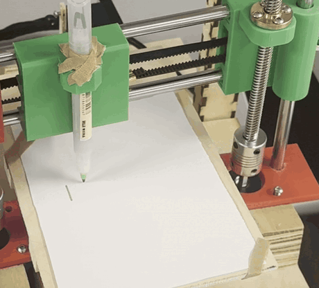

# Case study

Portfolio copy. Written to stand alone as a page, with the repo as the backing
evidence.

---

## Voice Plotter

**Voice-driven pen plotter. Four-person team, one semester.**

The team shipped it as AudioPrinter; I built the software.

I led the software for a desk-sized 3-axis machine that writes what you say. It
was built as an accessibility device, so the user has to operate it with almost
no hand movement, and it had to land near consumer-electronics cost.



### The problem

Writing by hand excludes people with limited hand mobility. Arthritis affects
18.6% of US adults, and 1.1 million Americans live with Parkinson's, a condition
whose medication runs around $2,500 a year for a population where 46.6% of
patients have household incomes below 200% of the poverty line.

The existing options each drop a requirement. A weighted pen still needs grip
and fine control. Voice to text is free but leaves nothing physical behind. A
printer reproduces files rather than the words you just spoke.

### What I built

A pipeline with a clean seam down the middle.

```
speech -> 16 kHz capture -> Speech-to-Text -> ASCII over serial -> stroke font -> 4 steppers
```

On the board: a 27-glyph stroke font authored on a 0-10 unit grid, a coordinate
transform from units to millimeters to stepper steps, a motor abstraction that
maps four stepper axes onto two I2C motor shields with a different sign
convention on each, and a serial protocol that carries renderable text, bench
jog commands, and an emergency stop.

On the host: microphone capture, cloud transcription, serial writes, a telemetry
thread that color-codes the board's log stream, and an operator menu with a
motor-test submenu so the machine could be commissioned without a terminal
session.

### Numbers

- 27 glyphs, 73 drawing operations, hand-authored, no font file.
- 7.0 mm glyphs on a 7.84 mm pitch, five per line, 40 mm of usable width.
- 10 steps per mm, so one letter box is 70 steps wide and tall.
- 5 letters printed in 89 seconds on the submission recording.
- Landed build cost $226.73.

### What was hard

**Sign conventions.** The belt, the platform, and the two mirrored lift motors
do not agree. Two of four axes run inverted, and the paired lift motors need
opposite directions to move together. This is invisible until a print comes out
mirrored, which is exactly what happened.

**Glyph geometry as a debugging target.** The first complete alphabet printed
legibly and wrong: curves swapped ends, `Q`'s tail and `K`'s leg went the wrong
way, `P` and `R` flipped. Late revisions are almost entirely geometry, verified
by printing and reading the paper, because there was no unit test that could
tell you a letter looked backwards.

**Hardware that arrived late.** Speech and motion were developed as separate
systems against a virtual COM port pair, then integrated once the frame existed.
That split is why the timeline survived, and why the first integrated print
needed coordinate fixes rather than architectural ones.

### What I would do differently

The machine is open loop, with no endstops and no position feedback, and the
motion functions block until they reach their target. Both were deliberate
trade-offs to ship in one semester, and both are the first things I would fix:
endstops and homing, then a non-blocking motion state machine so a stop works
mid-stroke and speed can rise without losing control.

After that: glyph data loaded at runtime instead of compiled in, a look-ahead
planner so the pen stops overshooting stroke corners, digits and punctuation,
and on-device speech recognition so the device is not tethered to a laptop.

### What I took from it

The software was never the hard part in isolation. Every difficult bug lived at
a boundary: font space against paper space, one motor's direction against
another's, a blocking loop against an operator who wants to stop the machine
now. The most useful thing I built was the instrumentation that made those
boundaries observable from a serial log.

---

### Author

Andrew Liu. Software: software architecture, stroke font, serial protocol,
speech front end, code flowcharts, integration testing.

Built for EG-UY 1004 SLDP, NYU Tandon, Fall 2025.
